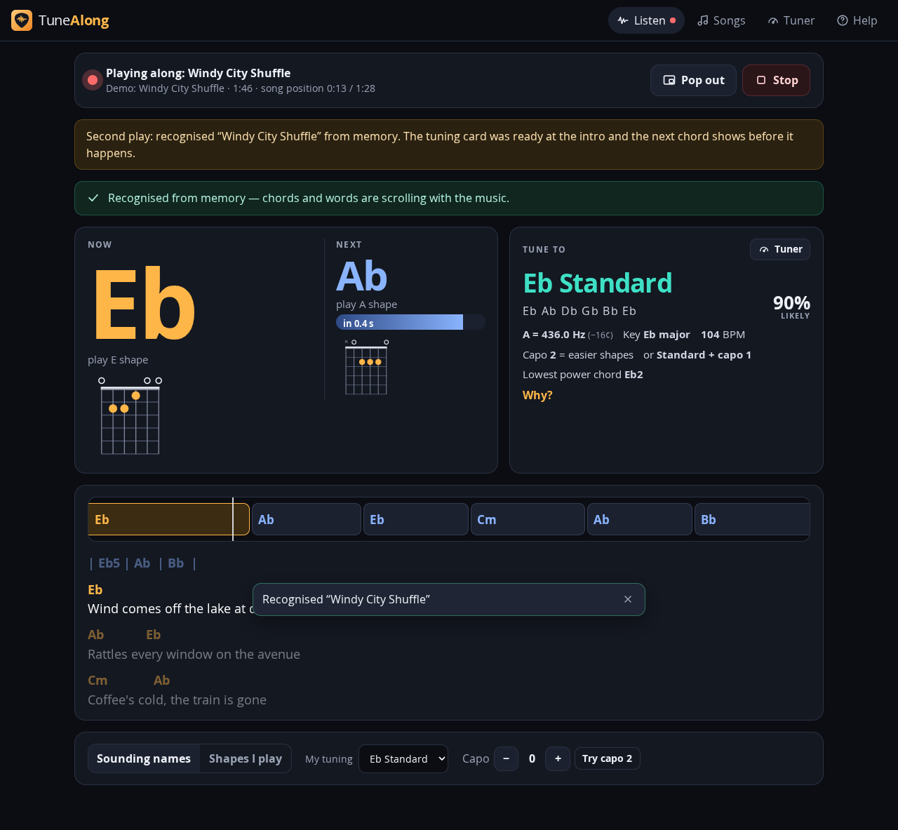
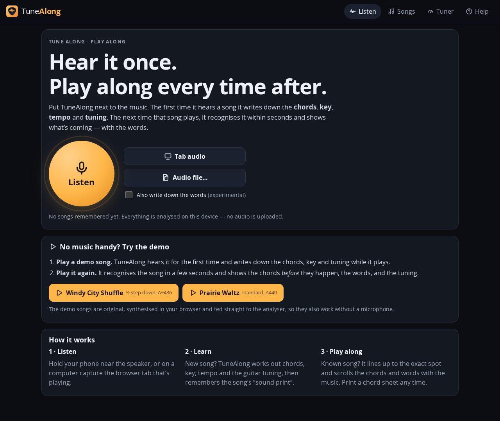
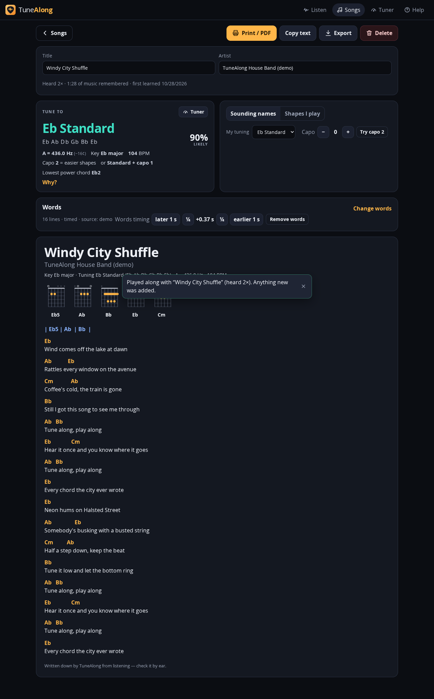

# TuneAlong · Play Along

**Hear a song once. Play along every time after.**

TuneAlong listens to music (microphone, a browser tab, an audio file, or the built-in demo).
The first time it hears a song it writes down the **chords, key, tempo, reference pitch and likely
guitar tuning**, and remembers the song's acoustic "sound print". The next time that song plays it
recognises it within a few seconds, finds the exact spot in the song, and shows the **current and next chord**,
chord diagrams, the **tuning card from the very start of the intro**, and the **words with chords above
them**. You can **print** a chord sheet with the words.



| Start | Chord sheet (prints black-on-white, see [sample PDF](docs/sample-chord-sheet.pdf)) |
|---|---|
|  |  |

## Status: what's been checked

| Level | Status |
|---|---|
| Implemented | Yes — web app / installable PWA in this folder (v0.1) |
| Tested | 49 automated tests pass (`npm test`), plus 2 opt-in checks: an 8-check real-browser run (headless Chrome 153) and a real-recordings check |
| Deployed | **No.** It runs as a local preview. Publishing needs the owner's go-ahead ([Deploying](#deploying)). |
| Checked on real phones and speakers | **Not yet.** The microphone path was tested with Chrome's fake microphone playing a degraded recording, not with a real phone in a real room. |

Measured results (reproduce them with the commands below):

- **Demo song, end to end in the engine** (`test/engine.e2e.test.ts`):
  - Chords: 100% correct, scored per bar at the major/minor level.
  - Key: Eb major. Tempo: 103.7 BPM (true value 104).
  - Reference pitch: −15.8¢ (true value −15¢).
  - Guitar tuning: Eb Standard ranked first.
  - Recognition through a simulated phone channel (low-pass, echo, hiss at 8 dB SNR) took 3.6 s.
  - A different song was correctly not claimed.
  - A 48 kHz replay was still recognised.
  - Analysis runs about 100× faster than real time.
- **Real recordings** (3 Creative-Commons tracks, simulated phone channel; `REAL_AUDIO_DIR=… npx vitest run test/real-audio.test.ts`):
  - 10/10 excerpts recognised, all at the exact position. Median time to recognise: 3.6 s.
  - 0 matched to the wrong song.
  - 0/3 false matches when the song was not in the library.
  - Chord accuracy on real recordings is **not measured**, because no chord annotations were available.
- **Real browser** (`scripts/browser-smoke.mjs`):
  - The demo was learned, then recognised 3.0 s into its second play.
  - Shapes mode worked.
  - The chord sheet rendered and printed to PDF.
  - The microphone path (fake mic playing a degraded copy) recognised the song after 9.3 s, counted from pressing Listen.
  - The pop-out overlay rendered.
  - No console errors.

## Try it

Needs Node.js 22.12 or newer (the test runner requires it; the dev server alone runs on 20.19+).

```bash
cd tune-along
npm install
npm run dev          # http://localhost:5173  (or: npm run build && npm run preview → :4173)
```

**Phones need an https:// address.** `npm run dev` also prints a `Network:` address such as
`http://192.168.1.20:5173`. A phone on the same Wi-Fi can open it, but it is plain http, so the browser blocks
the audio engine and the microphone there. TuneAlong shows a red notice saying so. Open the app on a phone from an
https:// host instead (see [Deploying](#deploying)). On the computer itself, `http://localhost` counts as secure and works.

1. Press **Windy City Shuffle** under *Try the demo*. TuneAlong hears it for the first time.
   - The tuning card reads *Eb Standard, A ≈ 436 Hz* within seconds.
   - When the song ends it is saved.
2. Press **Play it again**. It is recognised in about 3 s, and the next chord shows before it happens, with the words.
3. Open **Songs** → the song, then press **Print / PDF**.
4. With real music:
   - On a phone, press **Listen** near the speaker.
   - On desktop Chrome or Edge, press **Tab audio** and share the tab that is playing.
   - The microphone needs HTTPS (or localhost). Inside an embedded preview frame, open the page in its own tab.

## What it does

| Request from Dennis | What TuneAlong does today |
|---|---|
| Picks up chords the first time | Detects these chords live and decodes them cleanly when the song ends (Viterbi): maj, min, 7, m7, maj7, sus2, sus4, dim, aug, 5 (power chords). |
| …notes | Shows the "notes heard right now" display and the key. **It does not write down the melody or riffs** (see Roadmap). |
| …and words | 1. Timed lyrics from [LRCLIB](https://lrclib.net) (free, community-run), or lyrics you paste in.<br>2. An optional "write down the words" mode that uses the browser's speech recogniser. This is experimental: speech engines handle singing over a band poorly. |
| Displays them next time | Landmark audio fingerprinting recognises the song. It also handles repeated sections (chorus 1 vs chorus 2) and parts it missed the first time (each play fills in the gaps). |
| Knows the tuning at the start of the intro | Measures the reference pitch (A = … Hz) from the audio. The guitar tuning is an inference, shown with a probability: Standard / Eb / D / Drop D / C# / C / B. It also suggests a capo and a "standard + capo" alternative. A recognised song shows its tuning card about 3 s into the intro. |
| Overlays when music plays | 1. **Pop out** gives an always-on-top mini window. On desktop Chrome/Edge/Firefox it uses Document Picture-in-Picture; elsewhere it falls back to video picture-in-picture where supported.<br>2. TuneAlong splits songs automatically at silences, so it can listen to a whole playlist.<br>3. See the platform limits below. |
| Print the chords with the words | Chord sheet with the chords placed above the words, chord diagrams, and a header with key, tuning and capo. You can switch between "Sounding names" and "Shapes I play" (for a capo or a tuned-down guitar). |
| Extras | Tuner (with the song's own tuning and A-reference, plus reference tones for each string); library export/import (JSON); offline PWA; screen wake-lock while playing along. |

## Platform limits (by design of the platforms, not bugs)

- **iPhone/iPad:**
  - Apps cannot draw over other apps.
  - A web app cannot hear other apps' audio.
  - Use the microphone with the music playing from another device or speaker.
- **Android:** a web app hears the microphone only. Hearing another app's playback directly needs a native app using `AudioPlaybackCapture`, and apps such as Spotify can opt out of being captured.
- **Document Picture-in-Picture** is desktop-only (Chrome/Edge 116+, Firefox 151+).
- A web page cannot listen in the background after it is closed. "Whenever music is played" means: while TuneAlong is open and listening.

## How it works

```
mic / tab / file / demo ─► AudioWorklet (mono, 2048-sample chunks) ─► Web Worker: AnalysisEngine
  StreamResampler → 11,025 Hz (identical on every device)
  ├─ 4096-pt FFT, hop 93 ms → spectral peaks
  │    ├─ TuningEstimator: circular mean of partial deviations (skips 5th/7th harmonics) → A = … Hz
  │    ├─ chroma (tuning-compensated) + bass chroma → 120 chord templates (+ no-chord)
  │    │    → online decoder (live) / Viterbi (final)  → chord timeline
  │    ├─ Krumhansl–Kessler key; low root-fifth-octave "stacks" → tuning evidence
  │    └─ inferTuning(): evidence + chord-shape playability + prior → ranked tunings, capo advice
  └─ 1024-pt FFT, hop 23 ms → landmark peaks → 24-bit pair hashes (≈20–40/s)
       ├─ onset envelope → tempo
       └─ FingerprintIndex (radix-sorted Uint32Array) ← offset-histogram voting each second
            → "which song, where in it" (repeat-aware, continuity-preserving)
segment ends at silence → new song (IndexedDB) or merged into the known song
```

All analysis runs **on the device**. No audio is uploaded or stored; only the analysis and the hashes are kept.

## Project layout

```
src/dsp/        fft, resample, pitch (YIN), chroma + tuning estimate, chords (templates/Viterbi),
                key, tempo, tuning inference + capo, fingerprint (hashing/index/matching)
src/engine/     AnalysisEngine (streaming, segmenting, matching), analysis.ts, worker + protocol
src/audio/      capture (mic/tab/file/demo → worklet → worker), synth + demo songs (original)
src/music/      chord shapes (verified by test), chord-sheet layout, LRC parser
src/lib/        song model (create/merge/export), IndexedDB library, LRCLIB client, speech
src/app, src/ui React app: Listen, Songs (sheet/print/lyrics), Tuner, Help, pop-out overlay
public/         capture worklet, service worker, manifest, icons
test/           49 unit/e2e tests + opt-in real-audio and WAV-render tools
scripts/        browser-smoke.mjs (headless Chrome end-to-end), make-icons.mjs
docs/           screenshots, sample chord sheet, STRATEGY-MEMO.md (assessment)
```

## Commands

```bash
npm test                                   # 49 tests (+2 opt-in, skipped by default)
npm run build                              # type-check + production build → dist/ (static files)
WRITE_DEMO_WAV=/tmp/demo.wav npx vitest run test/tools.test.ts      # demo songs as WAV (play them to a phone)
REAL_AUDIO_DIR=/path/to/wavs npx vitest run test/real-audio.test.ts # learn + recognise your own recordings
npm i --no-save puppeteer-core @sparticuz/chromium && node scripts/browser-smoke.mjs   # real-browser run
```

In minimal Linux containers, the Chromium bundled by `@sparticuz/chromium` may need its own libraries. Extract `al2023.tar.br` and `swiftshader.tar.br` from that package and put them on `LD_LIBRARY_PATH`.

## Deploying

`npm run build` produces a static `dist/` folder that works from any sub-path. Any static host can serve it: GitHub Pages in a dedicated repo, Netlify, or Cloudflare Pages. This repository's own GitHub Pages slot is already used by its civic site, so TuneAlong should get its own home. **Nothing has been deployed.** That needs the owner's go-ahead.

## Data and licensing notes

- The demo songs, their lyrics and all code here are original to this project.
- Lyrics from LRCLIB are community-contributed. That is fine for personal use, but a commercial product needs licensed lyrics (LyricFind/Musixmatch). See [docs/STRATEGY-MEMO.md](docs/STRATEGY-MEMO.md).
- Recordings used for the opt-in real-audio check are not included in the repo.
